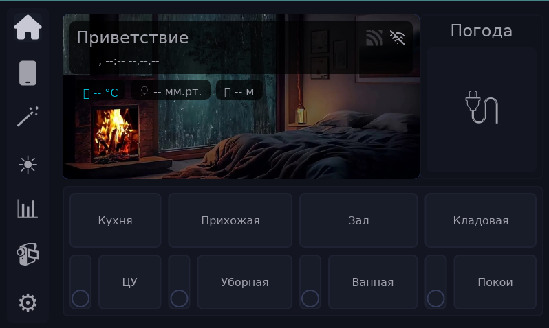

# SmartHome
- Проект предназначен для облегчения жизнедеятельности человека за счёт централизованного и удаленного управления за бытовыми устройствами, их автоматизации,а также контроля технических показателей помещений.
## [Цель]:
- Создать систему Умного Дома с собственным программным обеспечением, написанным на языке программирования **Rust** с адаптацией для встравиваемых систем. 
## [Задачи]:
  ### UI:
    - Построить архитектуру моделей дизайна для дисплеев инструментами Slint.
    - Реализовать логику взаимосвязи между визуальным отображением и микроконтроллером ESP32.
    - Отобразить 'Yandex Погоду' в UI всех дисплеев на разных уровнях влодженности. 
    - Настроить анимацию для плавного перехода цвета и перемещения объектов при выполнении пользователем действий.
    - Настроить отображение данных, поступаемых от датчика BMP180.
  ### Hard:
    - Настроить инициализацию дисплеев для разных разрешений.
    - Настроить инициализацию и работоспособность wifi модуля на дисплях ESP32.
    - Настроить синхронизацию даты и **времени через сеть.
    - Настроить инициализацию датчика BMP180.
    - Реализовать интеграцию с бесплатной версией сервиса 'Yandex Погода'.
    - Насторить управление дисплеев ESP32 по средствам передачи команд к кондиционеру. 
  ### MQTT:
    - Реализовать клиентскую часть MQTT на дисплеях ESP32.
    - Настроить корректную обработку подключения клиента к брокеру.
    - Настроить брокер MQTT на платах управления ESP32.
    - Настроить корректную обработку подключения с ограничением по количеству подключаемых пользователей до константного значения.
## [Компоненты]:
  - Waveshare ESP32-S3-ETH-8DI-RO- 8ми релейная плата управления (2 штук),
  - Waveshare ESP32-S3 7'- 7ми дюймовый емкостный сенсорный дисплей с разрешением 800×480 пикселей.
  - Waveshare ESP32-S3 4'- 4x дюймовый емкостный сенсорный дисплей с разрешением 480x480 пикселей.
### Используемые модули:
  - BMP180 - датчик температуры, давления, уровня моря. 
## [Структура проекта]:
### Проект разделен на несколько независимых модулей:
  ```  
  [SmartHome]:
    ├──[Display]          # модуль, отвечающий за визуальную часть проекта.
    ├──[LightControll]    # модуль, отвечающий за физическое управление освещением помещения.
    ├──Cargo.toml         # Файл с настройками Cargo проекта SmartHome
    ├──LICENCE
    └──README.md
  ```
## [Установка и запуск]:
  * Предварительная установка инструментов:
  1. Установка **espup** (Обязательно):
    ```cargo install espup```
  2. Установка **slint-viewer** (Рекомендуется):
    ```cargo install slint-viewer```
  - Команда для визуального отображения экрана на ПК: 
    ```slint-viewer ui/main_window.slint```
  * Описание установки [`Display`](./Display/README.md)
  * Описание установки [`LightControll`](./LightControll/README.md)
## [Дополнительно]:
  ### Пример дизайна главной страницы из утилиты **slint-viewer**:
  
